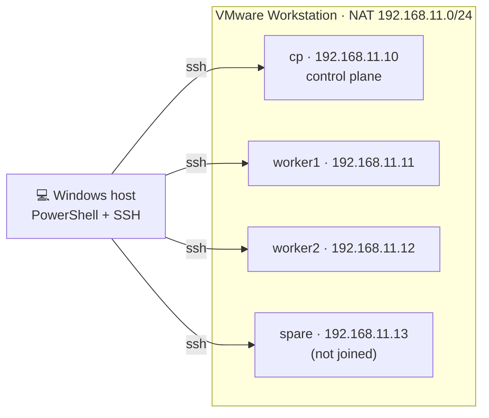

# 00 · Lab Setup: from VMware to a working Kubernetes cluster

A 3-node **kubeadm** cluster (plus one spare node) on VMware Workstation, built by hand the way the CKA exam expects.

---

## 1. Architecture



**Docker is NOT installed on the nodes.** Since v1.24, Kubernetes talks to **containerd** directly. Docker is only needed on the host if you use kind.

### The three IP ranges (must never overlap)
| Range | Used for |
|---|---|
| `192.168.11.0/24` | Nodes (the VMs) |
| `10.244.0.0/16` | Pods (set by `--pod-network-cidr`) |
| `10.96.0.0/12` | Services (kubeadm default) |

---

## 2. Create the VMs (VMware Workstation)

### 2.1 Find the NAT network (once)
**Edit → Virtual Network Editor → VMnet8 (NAT)**
- Subnet: `192.168.11.0`
- NAT Settings → Gateway: `192.168.11.2`
- DHCP range starts at `.128`, so static IPs `.10–.13` are safe

### 2.2 New VM wizard (first VM: `cp`)
**File → New Virtual Machine → Custom (advanced)**

| Screen | Choice |
|---|---|
| Guest OS install | **"I will install the operating system later"** (avoids Easy Install overriding hostname/IP) |
| Guest OS | Linux → Ubuntu 64-bit |
| Location | A local folder, **not OneDrive** (OneDrive would sync huge disk files constantly) |
| Processors | 1 processor × 2 cores |
| Memory | 4096 MB (cp), 2048–3072 MB (others) |
| Network | NAT |
| Disk | 25 GB (cp) / 20 GB (others), single file |

Then **Customize Hardware → CD/DVD → Use ISO** `ubuntu-24.04.5-live-server-amd64.iso`, tick *Connect at power on*. Remove the sound card.

ISO: https://releases.ubuntu.com/24.04/ (use **24.04**, not 26.04; tooling is better tested on 24.04)

### 2.3 Ubuntu installer
| Screen | Choice |
|---|---|
| Installer update | Continue without updating |
| Install type | **Ubuntu Server** (not minimized) |
| Network | `ens33` → Edit IPv4 → **Manual**: subnet `192.168.11.0/24`, address `192.168.11.10`, gateway `192.168.11.2`, DNS `8.8.8.8,1.1.1.1` |
| Mirror | Wait for "passed tests" (proves network + gateway work) |
| Storage | Entire disk, **untick LVM** (with LVM, `/` only gets ~half the disk) |
| Profile | Server name: `cp` (lowercase, no spaces) |
| SSH | ✅ Install OpenSSH server |
| Snaps | None |

After the reboot: VM → Settings → CD/DVD → **untick "Connect at power on"**.

Checks:
```bash
hostname            # cp
hostname -I         # 192.168.11.10
ping -c 3 google.com
```

Then:
```bash
sudo apt update && sudo apt upgrade -y
# stop the "upgrade to 26.04" prompt
sudo sed -i 's/^Prompt=.*/Prompt=never/' /etc/update-manager/release-upgrades
sudo poweroff
```
📸 Snapshot: **`base-os`**

---

## 3. Clone the other VMs

**Right-click cp → Manage → Clone → from snapshot `base-os` → Full clone** (not linked).
Set memory, then **boot the clone while cp is OFF** (both start with IP `.10`).

A clone copies things that **must be unique per Kubernetes node**. Fix them:

```bash
# 1. Hostname
sudo hostnamectl set-hostname worker1
sudo vim /etc/hosts                     # 127.0.1.1 worker1

# 2. IP (.10 → .11)
sudo vim /etc/netplan/50-cloud-init.yaml   # 192.168.11.11/24 (keep YAML indentation!)

# 3. Machine ID (kubeadm needs unique node identities)
sudo rm -f /etc/machine-id
sudo systemd-machine-id-setup

# 4. SSH host keys (each machine needs its own fingerprint)
sudo rm -f /etc/ssh/ssh_host_*
sudo dpkg-reconfigure openssh-server

sudo reboot
```

| Clone | IP | Hostname |
|---|---|---|
| worker1 | 192.168.11.11 | worker1 |
| worker2 | 192.168.11.12 | worker2 |
| spare | 192.168.11.13 | spare |

---

## 4. Name resolution & SSH

**On every VM:**
```bash
sudo tee -a /etc/hosts <<EOF
192.168.11.10 cp
192.168.11.11 worker1
192.168.11.12 worker2
192.168.11.13 spare
EOF
```

**On Windows:** add the same 4 lines to `C:\Windows\System32\drivers\etc\hosts` (Notepad as Administrator).

**Passwordless SSH from Windows (PowerShell):**
```powershell
ssh-keygen
type $env:USERPROFILE\.ssh\id_ed25519.pub | ssh <user>@cp "mkdir -p ~/.ssh && cat >> ~/.ssh/authorized_keys"
# repeat for worker1, worker2, spare
```

📸 Snapshot all 4: **`ready-os`**

---

## 5. Prepare the nodes: **S‑M‑S‑C‑K**

> 🧠 *"Some Monkeys Steal Cheese in Kubernetes"*: **S**wap · **M**odules · **S**ysctl · **C**ontainerd · **K**ube tools

Run on **cp, worker1, worker2** (leave `spare` bare for join practice).
Steps 1–3 each have two halves: **do it now** + **make it permanent**. Forgetting the permanent half breaks the node after a reboot.

### 5.1 S: Swap off
*Kubernetes wants real RAM. The kubelet refuses to run with swap on.*
```bash
sudo swapoff -a                  # now
sudo vim /etc/fstab              # permanent: put # before the /swap.img line
```
✔ `free -h` → Swap `0B`

> ⚠️ Ubuntu's fstab uses **tabs**. A sed like `/ swap /` won't match. Edit by hand, or use `sed -i '/\sswap\s/ s/^/#/' /etc/fstab`.

### 5.2 M: Kernel modules
*`overlay` = stacked container image layers. `br_netfilter` = the firewall can see traffic on the pod bridge.*
```bash
sudo modprobe overlay            # now
sudo modprobe br_netfilter       # now
sudo vim /etc/modules-load.d/k8s.conf    # permanent:
#   overlay
#   br_netfilter
```
✔ `lsmod | grep -E 'overlay|br_netfilter'`

### 5.3 S: Sysctl
*Send bridged traffic through iptables (kube-proxy and NetworkPolicy need it), and let the node forward packets like a router.*
```bash
sudo vim /etc/sysctl.d/k8s.conf          # permanent:
#   net.bridge.bridge-nf-call-iptables  = 1
#   net.bridge.bridge-nf-call-ip6tables = 1
#   net.ipv4.ip_forward                 = 1
sudo sysctl --system                     # apply now
```
✔ `sysctl net.ipv4.ip_forward` → `1`

> 💡 `sysctl: cannot stat .../bridge-nf-call-iptables` = **br_netfilter isn't loaded**. Order matters: modules before sysctl.

### 5.4 C: containerd
*The engine that actually runs containers. The kubelet talks to it via CRI.*
```bash
sudo apt-get update && sudo apt-get install -y containerd
sudo mkdir -p /etc/containerd
containerd config default | sudo tee /etc/containerd/config.toml > /dev/null
sudo vim /etc/containerd/config.toml     # /SystemdCgroup → false → true
sudo systemctl restart containerd        # apply
sudo systemctl enable containerd         # start at boot
```
✔ `grep SystemdCgroup /etc/containerd/config.toml` → `true`

**Why SystemdCgroup = true:** cgroups limit CPU/memory per process group. The kubelet and containerd **must use the same cgroup driver** (`systemd`). A mismatch causes random pod restarts and unstable nodes.

Remember: **install → config → true → restart → enable**

### 5.5 K: Kube tools (v1.34)
*kubeadm builds, kubelet runs, kubectl talks.*
Remember: **key → shop → buy → lock**
```bash
# key: lets apt verify packages really come from Kubernetes
sudo apt-get install -y apt-transport-https ca-certificates curl gpg
sudo mkdir -p -m 755 /etc/apt/keyrings
curl -fsSL https://pkgs.k8s.io/core:/stable:/v1.34/deb/Release.key \
  | sudo gpg --dearmor -o /etc/apt/keyrings/kubernetes-apt-keyring.gpg

# shop: the version lives in the URL (change it here when upgrading)
echo 'deb [signed-by=/etc/apt/keyrings/kubernetes-apt-keyring.gpg] https://pkgs.k8s.io/core:/stable:/v1.34/deb/ /' \
  | sudo tee /etc/apt/sources.list.d/kubernetes.list

# buy
sudo apt-get update
sudo apt-get install -y kubelet kubeadm kubectl

# lock: Kubernetes upgrades must be deliberate
sudo apt-mark hold kubelet kubeadm kubectl
```
✔ `kubeadm version -o short` → `v1.34.x`

> The kubelet shows `inactive (dead)` or `activating (auto-restart)` until `kubeadm init/join`, because `/var/lib/kubelet/config.yaml` doesn't exist yet. **That's normal.**

### 5.6 Verify a node (one line)
```bash
free -h | grep Swap; lsmod | grep -E '^overlay|^br_netfilter'; sysctl net.ipv4.ip_forward net.bridge.bridge-nf-call-iptables; grep SystemdCgroup /etc/containerd/config.toml; systemctl is-active containerd; kubeadm version -o short; apt-mark showhold
```

The ultimate test: **reboot**, then run it again.

📸 Snapshot: **`k8s-prereqs`**

---

## 6. Create the cluster (cp only)

```bash
sudo kubeadm init \
  --apiserver-advertise-address=192.168.11.10 \
  --pod-network-cidr=10.244.0.0/16
```
| Flag | Meaning |
|---|---|
| `--apiserver-advertise-address` | The cluster's "front door". API server at `https://192.168.11.10:6443` |
| `--pod-network-cidr` | Pod IP range. Must not overlap nodes (`192.168.11.x`) or services (`10.96.0.0/12`). Calico's default `192.168.0.0/16` would clash, so we use `10.244.0.0/16` (Flannel's default). |

**What `kubeadm init` does:** preflight checks → certificates (`/etc/kubernetes/pki/`) → kubeconfig files (`/etc/kubernetes/*.conf`) → **static pod manifests** (`/etc/kubernetes/manifests/`: etcd, kube-apiserver, kube-controller-manager, kube-scheduler) → starts the kubelet → installs CoreDNS + kube-proxy → prints a join command.

### Give your user kubectl access
```bash
mkdir -p $HOME/.kube
sudo cp -i /etc/kubernetes/admin.conf $HOME/.kube/config
sudo chown $(id -u):$(id -g) $HOME/.kube/config
```
`admin.conf` = **full admin credentials**. Never commit it to Git.

✔ `kubectl get nodes` → cp `NotReady` (expected: no CNI yet) · CoreDNS `Pending`

---

## 7. Install the CNI: Calico 3.31.4

> ⚠️ Calico **3.33** fails on Kubernetes **1.34** (needs MutatingAdmissionPolicy, which is off by default). See [troubleshooting #2](troubleshooting.md). Use **3.31.4**.

Install is operator-based: **CRDs** (new object types) → **operator** (the installer/manager) → **custom resources** (your "order form").

```bash
kubectl create -f https://raw.githubusercontent.com/projectcalico/calico/v3.31.4/manifests/operator-crds.yaml
kubectl create -f https://raw.githubusercontent.com/projectcalico/calico/v3.31.4/manifests/tigera-operator.yaml
kubectl get pods -n tigera-operator          # wait for Running, 0 restarts

curl -O https://raw.githubusercontent.com/projectcalico/calico/v3.31.4/manifests/custom-resources.yaml
vim custom-resources.yaml                    # cidr: 192.168.0.0/16 → 10.244.0.0/16
grep cidr custom-resources.yaml

kubectl create -f custom-resources.yaml
watch kubectl get pods -A
```
✔ `calico-system` pods Running · CoreDNS Running · cp **Ready**

---

## 8. Join the workers

On **cp**, get a fresh join command (tokens expire after 24 h):
```bash
kubeadm token create --print-join-command
```
On **each worker** (with `sudo`!):
```bash
sudo kubeadm join 192.168.11.10:6443 --token <token> --discovery-token-ca-cert-hash sha256:<hash>
```
| Part | Meaning |
|---|---|
| `--token` | Temporary password to get in (used once) |
| `--discovery-token-ca-cert-hash` | Fingerprint of the cluster CA, so the node can't be tricked into joining a fake cluster |

During join, the node sends a **certificate signing request (TLS bootstrap)** and receives its own permanent certificate.

Failed join? Fix the cause, then **`sudo kubeadm reset -f`** before joining again.

---

## 9. Verify

```bash
kubectl get nodes -o wide
kubectl get pods -A -o wide | grep -E 'calico-node|kube-proxy'
```
```
NAME      STATUS   ROLES           VERSION    INTERNAL-IP     CONTAINER-RUNTIME
cp        Ready    control-plane   v1.34.13   192.168.11.10   containerd://2.2.1
worker1   Ready    <none>          v1.34.13   192.168.11.11   containerd://2.2.1
worker2   Ready    <none>          v1.34.13   192.168.11.12   containerd://2.2.1
```
3× `calico-node` + 3× `kube-proxy`: **DaemonSets** automatically put one on every node.

📸 Snapshot cp, worker1, worker2: **`k8s-ready`**. Shut down workers first, cp last; start cp first.

---

## 📸 Snapshot map
| Snapshot | State | Use it to… |
|---|---|---|
| `base-os` | Fresh Ubuntu (cp) | Clone new nodes |
| `ready-os` | Unique identities, hosts, SSH | Redo node prep |
| `k8s-prereqs` | S‑M‑S‑C‑K done | Redo `kubeadm init` |
| `k8s-ready` | Working 3-node cluster | **Reset after every break-and-fix exercise** |
